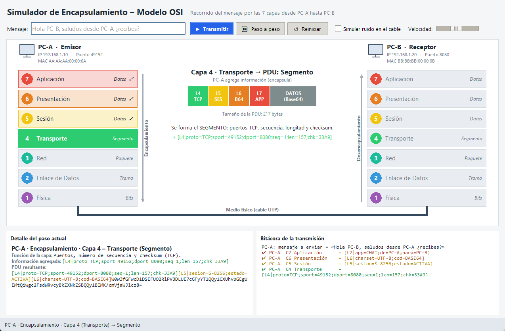

# Simulador OSI – Encapsulamiento y Desencapsulamiento

Simulador interactivo en Python (Tkinter) que muestra cómo un mensaje escrito en **PC-A** se
encapsula al bajar por las **7 capas del Modelo OSI**, viaja como bits por el cable y se
desencapsula en **PC-B** hasta recuperar el mensaje original.



## Requisitos

- Python 3.10 o superior (incluye `tkinter`; en Linux: `sudo apt install python3-tk`).
- Opcional: `pillow` (solo para generar capturas automáticas).

## Ejecución

```bash
git clone <URL-del-repositorio>
cd simulador-osi
python simulador_osi.py
```

Otros modos:

```bash
python osi_core.py "Hola PC-B"            # recorrido completo en la consola
python -m unittest -v                     # pruebas unitarias (15 pruebas)
pip install pillow
python simulador_osi.py --capturas capturas   # demo automática que guarda capturas
```

## Uso

1. Escriba el mensaje en el campo **Mensaje**.
2. Presione **▶ Transmitir** (recorrido automático) o **⏭ Paso a paso** (una capa por clic).
3. Observe el encapsulamiento en PC-A (capa 7 → 1), los bits en el cable y el
   desencapsulamiento en PC-B (capa 1 → 7).
4. Al final se compara el mensaje recibido con el original.
5. Marque **Simular ruido en el cable** para ver cómo la capa de Enlace (CRC32) descarta una trama dañada.

## Estructura

| Archivo | Contenido |
|---|---|
| `osi_core.py` | Lógica: funciones de encapsulamiento/desencapsulamiento por capa, Base64, CRC32, `transmitir()` |
| `simulador_osi.py` | Interfaz gráfica Tkinter y modo de capturas |
| `tests/test_osi_core.py` | Pruebas unitarias |
| `capturas/` | Capturas del simulador en funcionamiento |
| `docs/` | Manual técnico, guía de usuario y análisis de resultados |

## Qué agrega cada capa

| Capa | PDU | Información agregada en PC-A |
|---|---|---|
| 7 Aplicación | Datos | `[L7\|app=CHAT;de=PC-A;para=PC-B]` |
| 6 Presentación | Datos | Codificación UTF-8 → **Base64** + `[L6\|charset=UTF-8;cod=BASE64]` |
| 5 Sesión | Datos | `[L5\|sesion=S-XXXX;estado=ACTIVA]` |
| 4 Transporte | Segmento | Puertos TCP, secuencia, longitud y checksum |
| 3 Red | Paquete | IP origen, IP destino, TTL |
| 2 Enlace de Datos | Trama | MAC destino/origen + tráiler FCS (CRC32) |
| 1 Física | Bits | Conversión de la trama a 0 y 1 |
